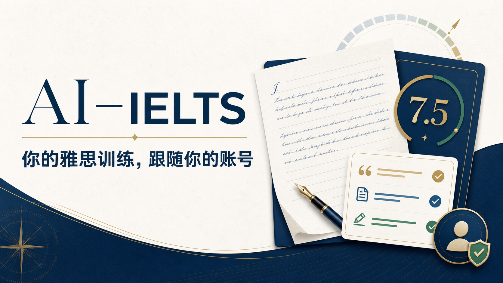

# AI IELTS Coach

<p align="center">
  <strong>从一次练习，到看得见的进步。</strong><br />
  面向 IELTS Academic 的开源机考练习与 AI 学习工作台。
</p>

<p align="center">
  <a href="https://github.com/LiRyan04/ielts-ai-coach-open-source/actions/workflows/ci.yml"></a>
  
  
  
</p>



> **内容边界：** 原创代码采用 MIT 许可证。IELTS、Cambridge 等第三方试题、文章、答案、音频、图片与商标不在授权范围内，也不应随公开版本分发。请只导入自己有权使用的材料。项目与 IELTS 官方及 Cambridge University Press & Assessment 无关联；AI 估分仅供练习参考。

## 这是什么？

AI IELTS Coach 把听力、阅读、写作、模拟考试、错题复盘和学习记录放进同一个工作台。你可以按机考节奏做题，保存草稿与答卷，再用自己的模型服务商密钥生成原创练习、分析错题或获取写作反馈。

项目适合想在本机搭建私人练习空间的 IELTS 学习者，也适合研究 Next.js、Cloudflare Workers、D1 和 AI 应用开发的开发者。**无需购买 AI Key 才能打开应用**；但生成题目、AI 导师和 AI 写作评审需要自行配置模型服务。公开源码不附带商业考试题库。

## 功能一览

| 模块 | 当前实现 |
| --- | --- |
| Listening | 分 Part 答题、计时、自动保存、题号导航、逐题评分；支持原音频、神经 TTS 与浏览器语音回退 |
| Reading | 文章与题目分栏、草稿续答、题号跳转、客观题评分与错题复盘 |
| Writing | Academic Task 1 / Task 2、字数与计时、自动保存、AI 四项评分和逐句建议 |
| 模拟考试 | Listening → Reading → Writing 连续笔试；考试答卷与日常练习记录分开保存 |
| 学习记录 | 待练题、草稿、已完成练习、考试场次、学习时长与打卡 |
| AI 导师 | 结合本人练习记录给出建议；生成原创练习及学习总结 |
| 材料导入 | 从有使用权的 PDF 提取题目、答案与原文，检查后保存到私人题库 |
| 账号设置 | 每位用户单独保存资料和模型配置，API Key 在服务端加密后存入 D1 |

> 系统主要面向 **IELTS Academic**。Speaking 目前提供独立题目练习，尚无完整的录音评分或真人考官流程。模考不会在写作、口语缺少可靠评分时伪装成官方 Overall Band。

## 5 分钟开始使用

### 1. 准备环境

- 安装 [Node.js](https://nodejs.org/) **22.18.0 或更新版本**。[.nvmrc](./.nvmrc) 记录了开发时使用的版本。
- 启用 [pnpm](https://pnpm.io/) **11.9.0**。首次安装依赖需要联网。
- Windows / PowerShell 用户可直接按 [WINDOWS.md](./WINDOWS.md) 操作。

先检查版本：

```bash
node --version
corepack --version
```

如没有 pnpm，可执行 `corepack enable` 和 `corepack prepare pnpm@11.9.0 --activate`；也可按 [pnpm 官方安装指南](https://pnpm.io/installation)安装同一版本。

### 2. 下载并安装

```bash
git clone https://github.com/LiRyan04/ielts-ai-coach-open-source.git
cd ielts-ai-coach-open-source
pnpm install --frozen-lockfile
```

下载 GitHub ZIP 也可以：解压后，在包含 `package.json` 的目录打开终端，从安装依赖这一步开始。

### 3. 创建本地配置

macOS / Linux：

```bash
cp .env.example .env.local
```

Windows PowerShell：

```powershell
Copy-Item .env.example .env.local
```

打开 `.env.local`，至少填写一个 **24 个字符以上的随机字符串**：

```dotenv
ACCOUNT_DATA_ENCRYPTION_KEY=replace-this-with-your-own-long-random-secret
```

它用于加密保存在数据库中的账号 API Key。请妥善保管，之后不要随意更换，否则已有 Key 将无法解密。其他变量可先留空，完整说明见 [.env.example](./.env.example)。`.env.local` 已被 Git 忽略；**不要把真实密钥发到 Issue、截图或提交到仓库**。

### 4. 启动

```bash
pnpm run dev
```

打开终端输出的本地地址，通常是 **http://localhost:3000**。首次启动会建立本地数据库表，可能要稍等片刻。开发模式默认使用本地测试身份；它仅用于本机体验，**不能充当公网登录方案**。

### 5. 做第一道题

1. 进入 **设置 → 模型设置**，选择服务商并填入自己的 API Key；也可以先浏览界面，稍后配置。
2. 在 **练习中心** 生成原创听力、阅读或写作题；也可以在 **导入材料** 中添加有权使用的 PDF。
3. 做题时输入答案，草稿会自动保存。交卷后查看评分、错题和 **我的练习**。
4. 想体验连续笔试时，从可用题库进入 **考试模式**。考试与日常练习的答卷、记录分别保存。

公开发行版不包含 Cambridge / IELTS 商业题目与音频，因此新安装时题库可能为空；这是正常状态，不是安装失败。

## AI 与语音怎么配置

在 **设置 → 模型设置** 中选择文本模型服务商、模型名称、API Base URL，再填写该账号自己的 Key。应用支持 OpenAI 兼容接口以及已适配的 OpenAI Responses、Anthropic、Bedrock、Gemini 格式；具体服务商与模型以设置页实际显示为准。TTS 可单独选择 MiMo、Qwen、OpenAI、Deepgram 或浏览器内置语音。

个人本地安装也可以把可选的服务端后备 Key 放在 `.env.local`；账号设置中的 Key 优先。**公开部署时不要用共享后备 Key 为陌生用户付费调用。** 模型与语音服务可能产生费用，请先查看所选服务商的额度和价格。

用户输入会发送给所选模型服务商以完成生成、诊断或评审。账号 Key 只在服务端处理，使用 `ACCOUNT_DATA_ENCRYPTION_KEY` 加密后存入 D1，前端不会重新读取完整 Key。请勿在练习材料中输入不愿发送给模型服务商的个人信息。

## 导入自己的练习资料

**导入材料** 支持按页选取 PDF 中的一篇 Reading Passage、一个 Listening Part 或一组 Writing Task。阅读和听力可指定答案页；听力可另选原文页。系统先尝试读取 PDF 文字层，扫描页可按需使用视觉模型。识别后可在预览中修正题目、答案与题号，再保存到私人题库。

- 只导入你有权使用的文件；**私人学习使用权不等于公开再分发权**。
- Writing Task 1 可以保留原题图表，避免重新绘制时改变数据。
- 导入结果保存在本地 / 私有部署数据库，不会自动提交到 GitHub。
- 没有现成材料时，可以先用 AI 生成原创题目验证完整流程。

## 项目结构

```text
app/                 页面、交互组件和服务端 API
content/             可替换的静态题库数据结构（公开版不含商业题库）
db/                  D1 初始化、数据访问与 Drizzle schema
drizzle/             数据库迁移文件
lib/                 评分、AI、语音、学习记录等业务逻辑
public/              公开静态资源；第三方文件保留各自许可证
scripts/             开发和内容转换脚本
tests/               Node.js 自动化测试
worker/              Cloudflare Worker 入口
```

技术栈：Next.js 16、React 19、TypeScript、Tailwind CSS 4、vinext / Vite 8、Cloudflare Workers、D1、R2、Drizzle ORM。学习数据保存在 D1，生成的语音可缓存到 R2。

## 开发与检查

```bash
pnpm run lint
pnpm test
```

`pnpm test` 会先构建，再运行 `tests/` 中的自动化测试。单独构建用 `pnpm run build`；只运行 Node 测试用 `node --test tests/*.test.mjs`。GitHub Actions 会对推送和 Pull Request 执行检查。

修改数据库结构时，请同时检查 `db/schema.ts` 和 `db/index.ts` 的初始化 / 兼容逻辑。提交 PR 前，请确认没有把 `.env.local`、用户数据、私人 PDF 或第三方题库放进 Git。

### 准备不含私人题库的公开快照

维护者本地副本可能有 Academic 21 等私人材料。**不要直接把本地工作目录推送到公开 GitHub 仓库。** 在项目根目录运行：

```bash
node scripts/create-public-release.mjs
```

脚本会在 `.release/public/` 生成一份独立快照：排除私人题库 JSON、音频、图片和本地 PDF，放入空题库结构与不依赖私人材料的评分测试。原始本地文件不变。发布前在这个快照中重新执行安装、构建、测试和内容检查，并以**全新 Git 历史**创建公开仓库；从含有私人材料的旧提交分支或直接推送，仍会把那些材料带进 Git 历史。

## 部署提示

本地开发使用模拟的 Cloudflare 绑定；公网部署还需要自行准备：

1. Cloudflare Worker 运行环境、名为 `DB` 的 D1 绑定；若启用语音缓存，还需名为 `TTS_AUDIO` 的 R2 绑定。[.openai/hosting.json](./.openai/hosting.json) 记录了绑定名。
2. 安全保存生产环境的 `ACCOUNT_DATA_ENCRYPTION_KEY`，并在所有实例保持一致。
3. **可信的身份验证入口。** 当前生产代码读取托管环境注入的登录身份请求头；直接暴露未配置身份代理的 Worker 并不能提供完整的公开注册 / 登录服务。
4. 只部署有权公开使用的题库与媒体文件，不要把本地私人材料打包进公开站点。

仓库还不是“一键公开运营”的成品。面向公众开放前，请先接入自己的身份系统，并检查服务商额度、数据保留策略与内容授权。

## 常见问题

<details><summary><strong>启动后题库是空的？</strong></summary>

公开源码不捆绑商业考试材料。配置自己的模型 Key 后生成原创练习，或导入有权使用的 PDF。

</details>

<details><summary><strong>提示缺少 DB 或 TTS_AUDIO？</strong></summary>

确认通过 `pnpm run dev` 启动，项目根目录有 [.openai/hosting.json](./.openai/hosting.json)，且 Cloudflare 开发插件安装成功。生产环境需要自己建立并绑定 D1 / R2。

</details>

<details><summary><strong>AI 生成或写作评审失败？</strong></summary>

先检查设置页的服务商、模型、Base URL 和 Key，再查看模型账户额度与服务器日志。无需 AI 的浏览器语音可在 TTS 设置中单独选择。

</details>

<details><summary><strong>Windows 提示无法运行 pnpm.ps1？</strong></summary>

按 [WINDOWS.md](./WINDOWS.md) 使用 `pnpm.cmd`，无需修改系统 PowerShell 执行策略。

</details>

<details><summary><strong>忘记加密密钥怎么办？</strong></summary>

原密钥无法从数据库恢复。已有账号 API Key 将无法解密，需要重新配置。请提前把生产密钥存进安全的密钥管理服务。

</details>

## 参与贡献

欢迎通过 Issue 报告可复现问题，或通过 Pull Request 改进练习体验、可访问性、测试和文档。提交问题时请附系统环境、操作步骤与预期结果，**不要附真实题库、用户答卷或 API Key**。涉及题库的改动，请使用原创、公开授权或合成测试数据，并标明来源与许可。

## 路线图

- [x] 听力、阅读、写作练习与草稿续答
- [x] 连续笔试模考和独立考试记录
- [x] AI 生成、错题诊断、写作反馈与学习总结
- [x] PDF 材料导入与私人题库
- [ ] 更完整的 Speaking 录音、发音与互动反馈
- [ ] 可公开再分发的原创示例题库
- [ ] 更通用的独立部署身份验证与安装向导

## 许可证与内容边界

原创源代码和项目文档采用 [MIT License](./LICENSE)。使用、修改和再分发时保留版权与许可证声明即可。第三方依赖或文件继续适用各自的许可证，详见 [第三方说明](./THIRD_PARTY_NOTICES.md)。

**MIT 不授权第三方 IELTS / Cambridge 题目、文章、答案、音频、图片、商标，也不授权使用者上传的私人内容。** 某些本地开发副本可能含有这些材料；公开发布前必须排除。项目名称中的 IELTS 仅用于说明备考用途，与官方无附属关系。
